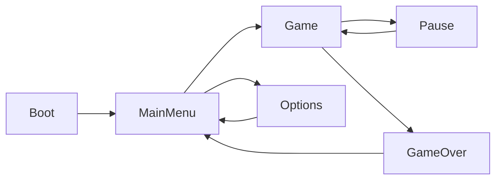

# UI en Godot 4

## Spec (`docs/ui/ui-spec.md`)

Por pantalla: propósito, wireframe ASCII, elementos (tipo de nodo, datos, estados), navegación
(foco inicial, vecinos, `ui_cancel`), eventos que emite/escucha, transiciones. Flujo global en mermaid:



## Estructura de una pantalla

```
MainMenu (Control, full rect, theme heredado)
└── MarginContainer (anchors full rect, márgenes del theme)
    └── VBoxContainer (alignment center)
        ├── Label %Title
        ├── Button %PlayButton
        ├── Button %OptionsButton
        └── Button %QuitButton
```

- Raíz `Control` con preset *Full Rect*; disposición con contenedores (`VBox/HBox/Grid/Margin/Center/PanelContainer`).
  Sin posiciones absolutas, salvo elementos anclados (HUD en esquinas con anchors).
- `size_flags` (`SIZE_EXPAND_FILL`) para repartir espacio; `custom_minimum_size` para tamaños mínimos táctiles (≥ 44 px a 720p).
- Escenas de UI en `godot/scenes/ui/`, scripts en `godot/src/ui/`. El HUD va en un `CanvasLayer` (layer 10); menús de pausa con `process_mode = PROCESS_MODE_ALWAYS`.

## Theme

- Un único `godot/assets/ui/theme/main_theme.tres` asignado en `project.godot` (`gui/theme/custom`) o en la raíz de la UI.
- Define: fuente por defecto y tamaños, colores de `Label`/`Button` (normal, hover, pressed, disabled, **focus visible**),
  `StyleBoxFlat`/`StyleBoxTexture` por estado, márgenes de `MarginContainer`, separación de contenedores.
- Variantes con `theme_type_variation` (p. ej. `TitleLabel`, `DangerButton`) en vez de overrides sueltos.
- Colores desde la paleta de `docs/art/style-guide.md`. Contraste de texto ≥ 4.5:1.

## Navegación

- En `_ready()` de cada pantalla: `%PlayButton.grab_focus()` (diferido si hace falta: `call_deferred`).
- Vecinos de foco automáticos por contenedores; fíjalos (`focus_neighbor_*`) en layouts irregulares.
- `ui_cancel` cierra/vuelve; `ui_accept` confirma. Probar todo solo con teclado y solo con mando.
- Ratón y foco coherentes: al hacer hover, opcionalmente `grab_focus()` para no tener dos selecciones.

## Arquitectura

- La UI **no tiene reglas de juego**: escucha (`EventBus.score_changed.connect(...)`, señales de componentes) y emite intenciones (`play_requested`).
- Cambios de pantalla vía un `SceneLoader`/`UIRouter` autoload, no `get_tree().change_scene_to_file` repartido por botones.
- Textos con `tr("MENU_PLAY")` y claves en `godot/assets/i18n/*.csv` si hay localización; si no, igualmente evita concatenar strings con datos (usa `%` o `format`).

## Escalado

- Pixel art: `display/window/stretch/mode="viewport"`, `scale_mode="integer"`; UI dibujada a resolución base.
- Vectorial/HD: `stretch/mode="canvas_items"`, `aspect="expand"`; probar 1280x720, 1920x1080, 2560x1440 y 4:3.

## Tests

Los scripts de `src/ui/` están exentos del test unitario obligatorio, pero la lógica de presentación
no trivial (formateo de tiempo, barras, listas) va en una clase pura testeable. QA cubre flujos de UI en integración
(`button.pressed.emit()` y comprobar la pantalla resultante).
